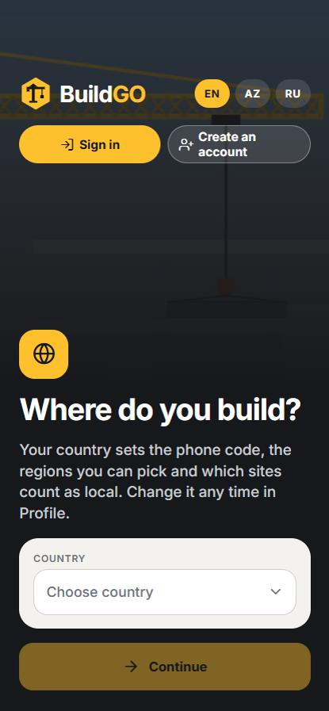
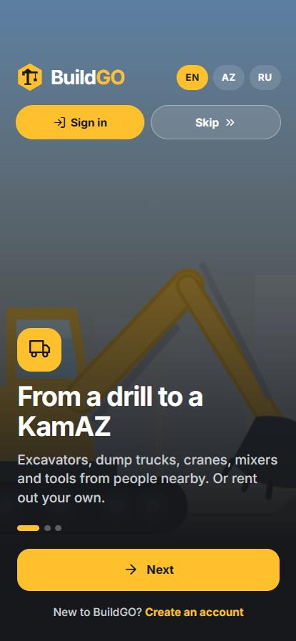
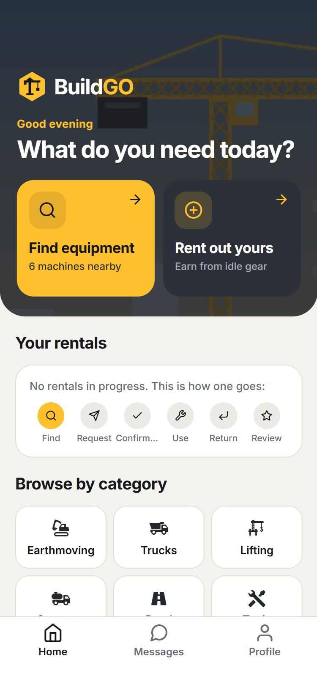
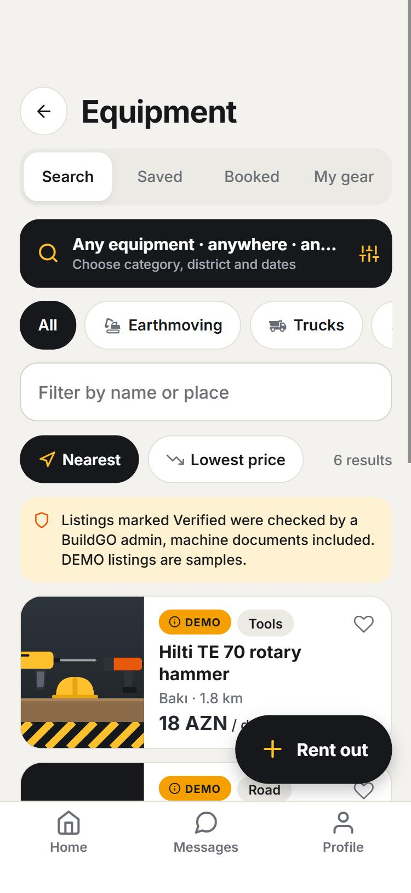
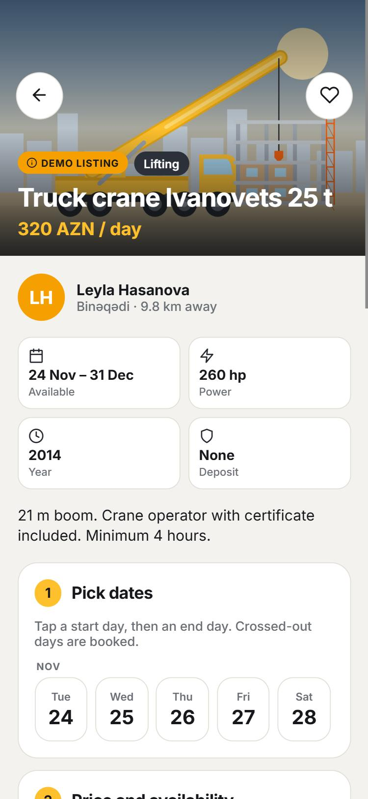
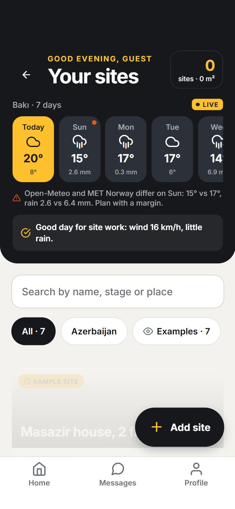

<p align="center"></p>

# BuildGO

**Construction equipment rental — from a rotary hammer to a KamAZ dump truck.**
An Android app (and the same app on the web) where builders find excavators, trucks, cranes, concrete mixers, road machinery and power tools from people nearby, or rent out their own. Built for Azerbaijan; English, Azerbaijani and Russian.

| Start | Intro | Home |
|---|---|---|
|  |  |  |
| **Equipment** | **Listing** | **Sites & weather** |
|  |  |  |

## Features

- **Six categories:** earthmoving, trucks, lifting, concrete, road, tools — 50+ machine types and ~80 brands with models (KamAZ, MAZ, HOWO, CAT, Komatsu, JCB, XCMG, SANY, Liebherr, Bosch, Hilti…).
- **Moderation:** every listing, machine and driving licence is checked by an admin before it goes live. Automatic checks: VIN (ISO 3779 check digit, manufacturer, year), Azerbaijani plates, licence format and expiry.
- **Licences and operator certificates:** road categories, self-propelled machinery TR-A…TR-E, crane and aerial-platform operators. The app tells a renter whether they may operate a given machine themselves.
- **Accounts and chats:** username + password (scrypt hashes, opaque session tokens), people search by name, chat requests, live chat over WebSocket with typing, read ticks and voice messages.
- **Construction sites:** stage, ground, power on site, area, work log, map pin, and a 7-day forecast cross-checked between Open-Meteo and MET Norway with site-work advice (crane wind limits, rain and frost for concrete).
- **Reference catalog:** every city and village of Azerbaijan (OpenStreetMap), kinds of work, building materials; typo-tolerant search across Latin and Cyrillic scripts.

## Stack

- **App:** Expo / React Native (new architecture, Hermes), expo-router, React Query, Reanimated
- **API:** Node.js, Express 5, `ws` WebSocket, PostgreSQL, Zod; OpenAPI 3.1 spec with generated client (Orval)
- **Monorepo:** pnpm workspaces, TypeScript

```
artifacts/agrolink     the mobile / web app
artifacts/api-server   the API server
lib/api-spec           OpenAPI contract → lib/api-client-react, lib/api-zod
lib/db                 schema and migrations
lib/reference          machines, brands, places, VIN / plate / licence checks
```

## Run locally

```bash
pnpm install
# .env in the repo root: DATABASE_URL, PORT=8080, ADMIN_USERNAME, ADMIN_PASSWORD_HASH (scrypt hash)
pnpm start                                           # local PostgreSQL + API on :8080
pnpm --filter @workspace/agrolink run dev            # app (web on :8081)
```

The API can be hosted on Render with a Neon database (`render.yaml`). Artwork in the app is original; place data © OpenStreetMap contributors (ODbL).
